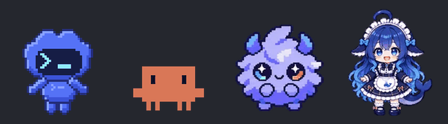
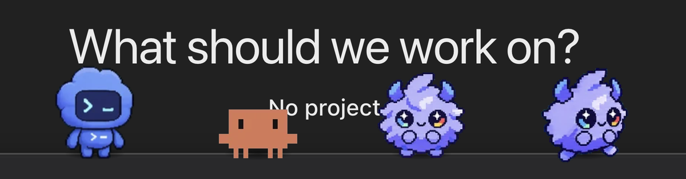
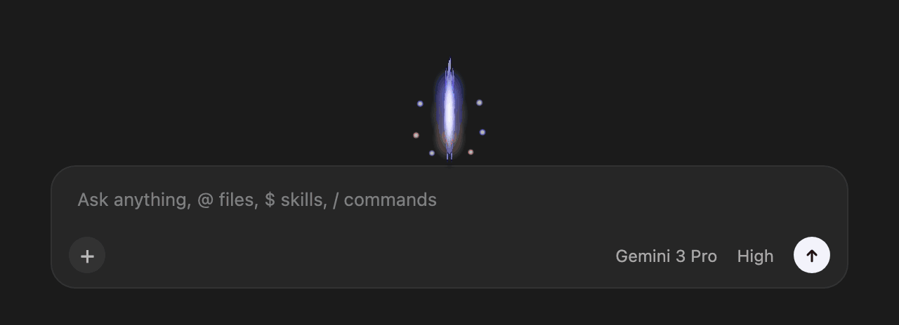
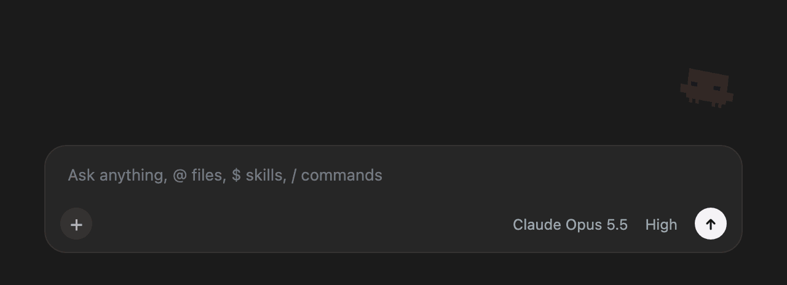
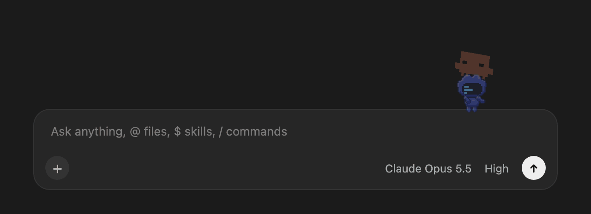
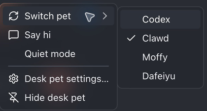
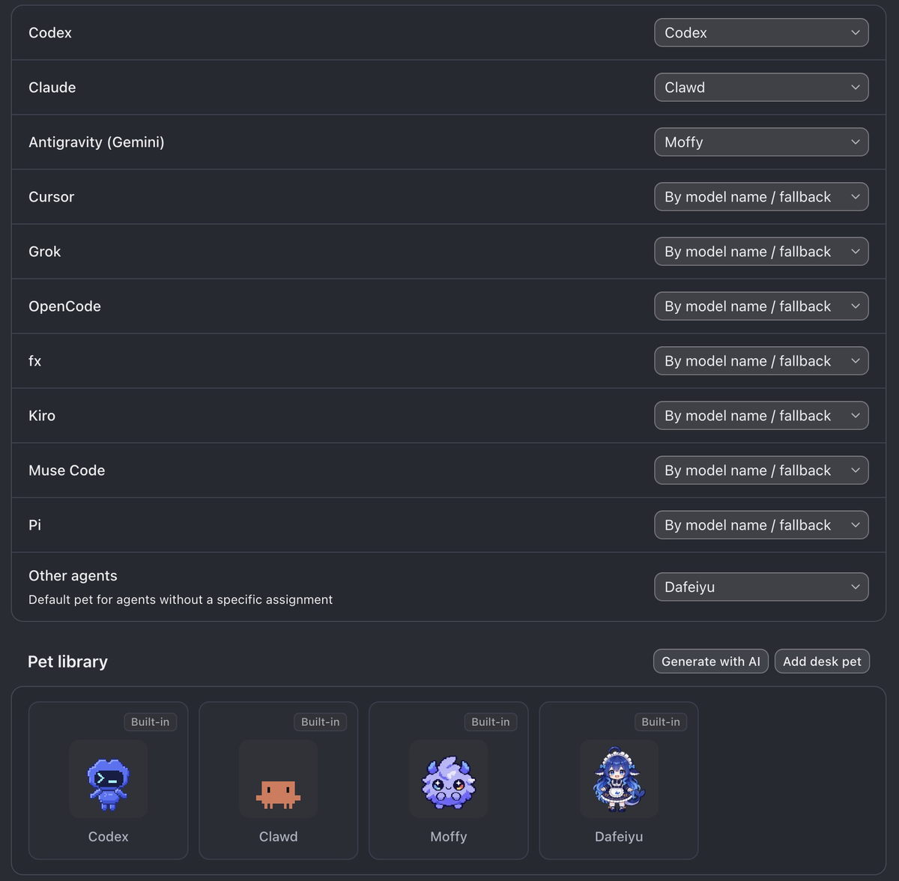
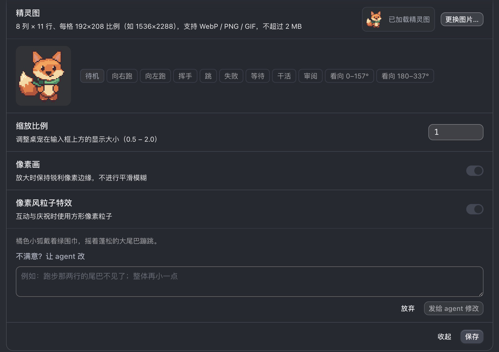

[简体中文](README.md) | **English**

# Desk pets

Pets for the current agent stand on the composer and react to the thread state; each subagent sends its own pet to work alongside. Choose a pet per agent, edit the pet library, or have one of your agents generate a new pet from a description or reference images.

Built in: a Codex-style pet for Codex, Clawd for Claude, Moffy for Antigravity (Gemini), and Dafeiyu, a whale-girl maid, for every other agent.





An extension for [T3 Code Extensions](https://github.com/ZiHao256/t3code-extensions), an unofficial extension host for [T3 Code](https://github.com/pingdotgg/t3code). Install it in Settings → Extensions → Browse, or paste `https://github.com/ZiHao256/t3x-desk-pets` into the URL field there. "Check for updates" offers this repository's latest release, installed after you confirm.

## Features

**Follows the thread**
- The pet on the composer belongs to the current thread's agent: it works while the agent is working, waits while you need to approve or answer, slumps on errors, idles otherwise, and now and then walks a few steps along the composer.
- When a thread finishes normally while the window is in the background, the pet jumps to celebrate. Celebrations and subagent entrances and exits that happen while the window is in the background are saved and replayed in order when you come back.
- The pet swells as the context fills up and gets restless near the limit; while T3 compacts history it squashes itself flat, then pops back.
- When you switch threads or agents, the old pet leaves and the new one enters.



**Subagents**
- When the main agent dispatches a subagent (anything T3 registers as a subagent, such as Claude's subagents or tasks sent to Codex or another provider with `delegate_task`), that agent's pet runs over to say hi, takes a seat and gets to work; the main pet turns to glance at it.
- When a subagent finishes, its pet high-fives the main pet and leaves; on failure it hangs its head for a moment first, and if it sits too far away it waves goodbye instead. When several finish at once, they say goodbye one after another.
- When there's no room left, a "+N" badge shows the rest, and they take seats as space frees up. Switch to another thread and back, and entrances and exits you missed are replayed.



**Playing with pets**
- Hover over the main pet and it waves; move the pointer nearby and its eyes follow it (16 directions).
- Click a pet and it jumps.
- The main pet and every subagent pet can be dragged along the top of the composer on their own; the main pet remembers where you put it.
- Drop one pet onto another and the two jump up and bump heads face to face, then step apart.
- Right-click a pet: switch pet, say hi, quiet mode, desk pet settings, hide. Hiding lasts until the next launch; right-click the model picker in the composer to bring them back, switch pets or toggle quiet mode.
- In quiet mode pets stay put: no wandering, no celebrations, and subagent pets simply sit down and leave. With the system's "reduce motion" setting on, pets also don't wander or turn to follow the pointer.





**Settings** (Settings → Extensions → Desk pets → Settings, or right-click a pet → Desk pet settings…)
- A pet for each agent: choose one for every harness configured in T3 and for "other agents", or choose "By model name / fallback" or "Hide pet".
- Pet library: add pets by uploading a sprite sheet; edit the name, scale, pixel art and pixel-art particles; delete them; or have an agent generate one (see below).



## Install with an agent

Paste this to Claude Code, Codex or another coding agent:

```text
Install the T3 Code extension "Desk pets" (https://github.com/ZiHao256/t3x-desk-pets) on this Mac.
1. Check that T3 Code Extensions 0.3 or later is installed (`git describe --tags` in its checkout shows v0.3.0 or later). If it is missing or older, install or update it first by following the "Install with an agent" section of https://github.com/ZiHao256/t3code-extensions/blob/main/README.en.md, and ask me before quitting T3 Code.
2. Open ~/Applications/T3 Code Extensions.app, go to Settings → Extensions → Browse, and install "t3x-desk-pets" from the community list, or paste https://github.com/ZiHao256/t3x-desk-pets into the link field and click Add. In the confirmation dialog, check that the source is ZiHao256/t3x-desk-pets before confirming.
3. In the Installed tab, make sure it is enabled and tell me its version.
If you can't operate the app's UI, do step 1, then tell me exactly what to click for steps 2 and 3.
```

## Generate a pet with an agent

Settings → Desk pets → Pet library → **Generate with AI**:

1. Enter a name, describe the pet, and optionally attach up to 4 reference images. Pick pixel art or a smooth illustration.
2. Choose where it runs: a new thread in "No project" or one of your projects, or an existing thread. For a new thread, also choose the harness (any provider you have configured in T3), the model and the runtime mode. An existing thread keeps its own harness.
3. Click **Generate**. The extension sends the brief to that thread; the agent draws the 8×11 sprite sheet and saves it to the extension's output folder (`<T3 data folder>/t3x-out/desk-pets/<job>/`). Writing there is outside the agent's workspace, so a sandboxed agent may ask you to approve it in the thread. Image-generation models give the best results; others draw pixel art with code. It usually takes 10–20 minutes, and you can close Settings in the meantime.
4. When the sheet arrives, preview every animation, adjust the name, scale and pixel options, and import it into the library. Not happy? Describe what to change and the same thread revises it into a new round folder; if a revision goes wrong, you can go back to the previous version.

This uses your own agent quota. The extension only starts threads or sends messages when you click Generate or send a revision. The agent has to run on this Mac (a local environment): the output folder is read from the local disk.



## Requirements

`apiVersion` 5 with the `agent` permission: it uses only the host's `host` API and doesn't read T3's page structure directly. Needs T3 Code Extensions 0.3 or later; older hosts refuse to install this version. The install dialog lists the permission.

The pet swells as the thread's context fills up and squeezes itself back while T3 compacts history. This needs a host that passes `context` / `compacting` to `chat.overlay` (T3 Code Extensions 0.2+); on older hosts the pet just keeps its size.

## Development

- `npm test` runs the tests (Node 22+, no dependencies).
- To try changes: Settings → Extensions → Add local extension, pick this folder, then click refresh on its card after each edit.
- `tools/swell-demo.html`: open it in a browser to tune the swell / squeeze animation with a slider.

## Sprite sheet

Settings → Desk pets → Add desk pet takes a sheet in this format; the generator asks the agent for the same.

8 columns × 11 rows of 192×208 cells (1536×2288 in total), the same atlas format as Codex desk pets:

| Row | Animation | Row | Animation |
|---|---|---|---|
| 0 | Idle | 6 | Waiting |
| 1 / 2 | Run right / left | 7 | Working |
| 3 | Wave | 8 | Review |
| 4 | Jump | 9–10 | Look frames for 16 directions (0° is up, clockwise) |
| 5 | Failed | | |

Pet definitions (entries in `pets.js`; pets added in Settings use the same fields): `name`, `scale` (0.5–2), `pixelFx` (square pixel particles), `smooth` (not pixel art), `badgeBottom` (height of the subagent "+N" badge), `vars` / `darkVars` (`--t3x-pet-*` and `--t3x-sub-*` CSS variables that calibrate where the pet stands and the particle colors; see the defaults in `pets.css`). The bundled Codex-style pet is drawn frame by frame in code by `tools/codex_atlas.py`.

## Release

1. Change the code, bump `version` in `plugin.json`, run `npm test`, and commit.
2. Tag that commit `v<version>`, push it with the tag, and publish a GitHub release ("Check for updates" reads the latest release).

## License

MIT

The Clawd and Moffy sprites are the author's own non-commercial fan pixel art; the characters belong to their respective owners (Clawd is Anthropic's Claude mascot) and are not covered by the MIT license. Open an issue to request removal.

The Dafeiyu sprite sheet (`pets/whale/`) is an unofficial fan work of the whale girl (鲸鱼娘, nicknamed 大肥鱼 "Dafeiyu"), a character the community built around DeepSeek's whale logo; she is not an official DeepSeek character, and this project is not affiliated with DeepSeek. The sheet is based on the chibi reference sheet "Q 版大肥鱼" (`characters/dafeiyu/reference-sheets/dafeiyu-chibi-character-sheet.png`) from the community asset library [TreapGoGo/deepseek-whale-girl](https://github.com/TreapGoGo/deepseek-whale-girl). The character is commonly credited to 溟月 (Mingyue), an original character by the Bilibili creator 上善无形 (June 2025), later reworked into the maid version by ZipZipPipe. The sheet is not covered by the MIT license: it is shared under [CC BY-NC-SA 4.0](https://creativecommons.org/licenses/by-nc-sa/4.0/) (attribution, non-commercial, share-alike). If you are a rights holder and object, open an issue and it will be removed.
