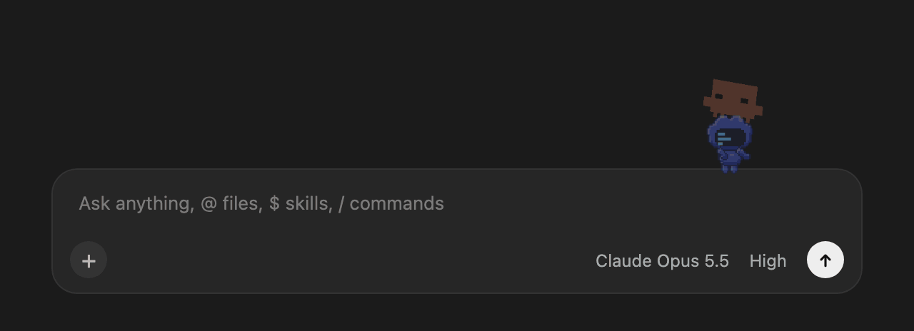
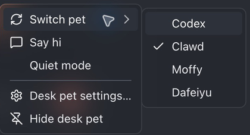
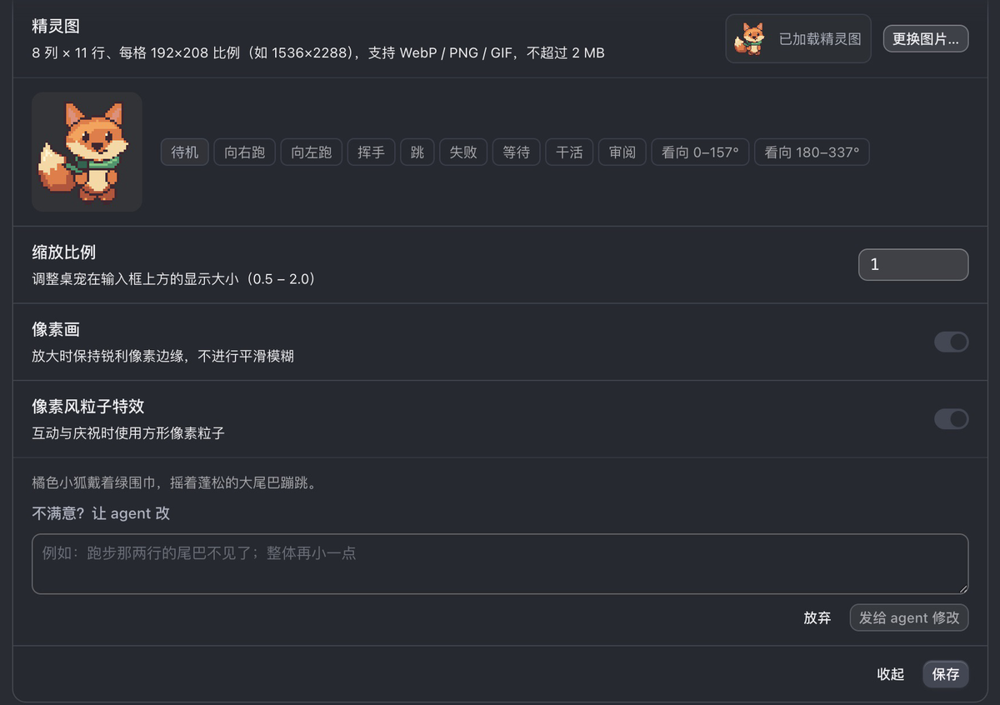

**简体中文** | [English](README.en.md)

# 桌宠

输入框上沿站着当前 agent 的宠物，跟着会话状态动；子代理各派一只到旁边干活。每个 agent 用哪只、宠物库都能自己改，也能让你配置的 agent 照描述或参考图生成新宠物。

内置四只：Codex 用 Codex 风格的那只，Claude 用 Clawd，Antigravity（Gemini）用 Moffy，其他 agent 默认用鲸鱼娘女仆 Dafeiyu。


[T3 Code Extensions](https://github.com/ZiHao256/t3code-extensions) 的扩展，T3 Code Extensions 是 [T3 Code](https://github.com/pingdotgg/t3code) 的非官方扩展宿主。在 设置 → 扩展 →「浏览」里安装，或者把 `https://github.com/ZiHao256/t3x-desk-pets` 粘贴到那里的链接框。「检查更新」取本仓库的最新 Release，确认后安装。

## 功能

**跟着会话动**
- 输入框上站的是当前会话 agent 的宠物：agent 干活时埋头工作，等你审批或回答时在原地等，出错时垂头丧气，闲着时待机，偶尔沿输入框上沿走几步。
- 会话在窗口不在前台时正常跑完，宠物会跳起来庆祝；不在前台期间攒下的庆祝和子代理进出场，回到窗口后按顺序补播。
- 上下文越满宠物越胖，快满时坐立不安；T3 压缩历史时它把自己挤扁，压完“噗”地弹回。
- 换会话或换 agent 时，旧宠物离场，新的那只入场。


**子代理**
- 主 agent 派出子代理（T3 里登记为子代理的都算，比如 Claude 的子 agent、`delegate_task` 委派给 Codex 等其他 provider 的任务）时，对应 agent 的宠物跑过来打招呼，落座后埋头干活；主宠物会转头看它一眼。
- 子代理完成时和主宠物击掌后离开，失败时垂头一会儿再走，离得太远够不着时挥手告别；好几只同时收工就排队依次告别。
- 坐不下时显示“+N”，腾出座位再补上来。切到别的会话再回来，离开期间的进出场会补播。
- 有自己会话的子代理（`delegate_task` 这类）在等你批准或回复时，它的宠物举起牌子，点牌子跳到那个子代理的会话；挤在“+N”里的在等你时，徽标变成“! +N”，点它跳到第一个在等的。需要宿主 0.5.0 起；模型自带的子代理（比如 Claude 的子 agent）没有自己的会话，不举牌子。


**和宠物互动**
- 鼠标移到主宠物身上它会挥手；鼠标在附近移动时，它的眼睛跟着指针转（16 个方向）。
- 单击宠物，它会跳一下。
- 主宠物和每只子宠物都能沿输入框上沿单独拖动，主宠物的位置会记住。
- 把一只宠物拖到另一只身上松手，两只会面对面跳起来碰头，然后分开站好。
- 右键宠物：换一只宠物、打个招呼、安静模式、桌宠设置、隐藏桌宠。隐藏只在这次启动内有效，右键输入框里的模型选择器可以叫回来，也能在那里换宠物、开关安静模式。
- 安静模式下宠物原地待着：不闲逛、不庆祝，子代理直接落座和离开。系统开了“减弱动态效果”时，宠物也不闲逛、不跟着指针转头。





**设置**（设置 → 扩展 → 桌宠 →「设置」，或右键宠物 →「桌宠设置…」）
- 每个 agent 用哪只：T3 里配置的每个 harness 和“其他 agent”各选一只，也可以选“按模型名 / 同其他 agent”或“不显示”。
- 宠物库：上传精灵图添加，编辑名称、缩放、像素画和像素风粒子，删除；也可以让 agent 生成（见下文）。


## 让 agent 安装

把下面的提示词发给 Claude Code、Codex 等 coding agent：

```text
帮我在这台 Mac 上给 T3 Code 装「桌宠」扩展（https://github.com/ZiHao256/t3x-desk-pets）。
1. 确认已安装 T3 Code Extensions 0.3 或更新版本（在它的仓库目录跑 `git describe --tags`，应为 v0.3.0 或更新）。没装或版本旧，先按 https://github.com/ZiHao256/t3code-extensions 里「让 agent 安装」一节装好；要退出 T3 Code 前先问我。
2. 打开 ~/Applications/T3 Code Extensions.app，进入 设置 → 扩展 →「浏览」，在社区扩展里安装 t3x-desk-pets；或者把 https://github.com/ZiHao256/t3x-desk-pets 粘贴到链接框里点「添加」。确认框里核对来源是 ZiHao256/t3x-desk-pets 再确认。
3. 在「已安装」里确认它已启用，告诉我版本号。
如果你没法操作应用界面，做完第 1 步后，把第 2、3 步具体点哪里告诉我。
```

## 让 agent 生成桌宠

设置 → 桌宠 → 宠物库 →「AI 生成」：

1. 填名字、写描述，可以附最多 4 张参考图；选像素画或平滑插画。
2. 选在哪儿跑：在「无项目」或某个项目里新开会话，或者发到已有会话。新会话还要选 harness（T3 里配好的任意 provider）、模型和运行模式；已有会话沿用它自己的 harness。
3. 点「生成」，扩展把要求发给那个会话，agent 画好 8×11 精灵图，存进扩展的输出目录（`<T3 数据目录>/t3x-out/desk-pets/<任务>/`）。那里在 agent 工作区之外，沙箱模式下它可能在会话里请你批准。能出图的模型效果最好，不能出图的会用代码画像素画。一般要十几分钟，期间可以关掉设置。
4. 图到了以后可以逐个动作预览，调名字、缩放和像素选项，再导入宠物库。不满意就写下要改什么，同一个会话接着改，每轮写进新文件夹；改坏了可以回到上一版。

用的是你自己的 agent 额度；只有你点「生成」或发修改意见时，扩展才会开会话、发消息。agent 要跑在这台 Mac 上（本机环境），输出目录是从本机磁盘读的。



## 依赖

依赖宿主的 `host` 接口（`apiVersion` 5，声明了 `agent` 权限），不直接读 T3 的页面结构。需要 T3 Code Extensions 0.3 起，旧版宿主会拒绝安装；安装确认框里会列出这项权限。

宠物随会话上下文变满逐渐变胖，T3 压缩历史时把自己挤小、压完“噗”地弹回。需要宿主给 `chat.overlay` 传 `context` / `compacting`（T3 Code Extensions 0.2 起）；旧宿主上宠物保持原样大小。

## 开发

- `npm test` 运行测试（Node 22+，不依赖 npm 包）。
- 试改动：设置 → 扩展 →「添加本地扩展」选本仓库目录，改完点卡片上的刷新。
- `tools/swell-demo.html`：浏览器打开它，用滑块调膨胀和压缩动画。

## 精灵图格式

设置里「添加桌宠」直接导入这种格式的图，AI 生成也让 agent 按它来画。

8 列 × 11 行，每格 192×208（整张 1536×2288），和 Codex 桌宠的图集格式一致：

| 行 | 动作 | 行 | 动作 |
|---|---|---|---|
| 0 | 待机 | 6 | 等待 |
| 1 / 2 | 向右 / 向左跑 | 7 | 运行中 |
| 3 | 挥手 | 8 | 审阅 |
| 4 | 跳 | 9–10 | 16 个方向的看向帧（0° 朝上顺时针） |
| 5 | 失败 | | |

宠物定义（`pets.js` 里的条目，设置里添加的宠物也用这些字段）：`name`、`scale`（0.5–2）、`pixelFx`（粒子用像素方块）、`smooth`（非像素画）、`badgeBottom`（子代理 “+N” 徽标高度）、`vars` 里的 `--t3x-pet-sign-y`（头顶离脚底多高，子代理举的牌子的木棍落在这里，默认 56px）、`vars` / `darkVars`（`--t3x-pet-*`、`--t3x-sub-*` CSS 变量，用来校准落地位置和粒子颜色，见 `pets.css` 的默认值）。自带的 Codex 风格宠物由 `tools/codex_atlas.py` 用代码逐帧画出。

## 发版

1. 改代码和 `plugin.json` 的 `version`，跑 `npm test`，提交。
2. 在这个提交上打 `v<version>` 标签，连标签一起推送并发布 GitHub Release（「检查更新」看的是最新 Release）。

## 社区

本项目积极参与并认可 [LINUX DO 社区](https://linux.do)。

## 许可

MIT

Clawd、Moffy 精灵图是作者自己绘制的同人像素形象，仅供非商业使用；角色形象归原权利方所有（Clawd 是 Anthropic 的 Claude 吉祥物），不在 MIT 授权范围内。如有异议请开 issue，会撤下。

Dafeiyu 精灵图（`pets/whale/`）是鲸鱼娘（又称“大肥鱼”）的非官方同人作品。鲸鱼娘是社区围绕 DeepSeek 鲸鱼标志创作的形象，不是 DeepSeek 官方角色，本项目与 DeepSeek 无关。这张图参考了社区资源库 [TreapGoGo/deepseek-whale-girl](https://github.com/TreapGoGo/deepseek-whale-girl) 里的「Q 版大肥鱼」设定图（`characters/dafeiyu/reference-sheets/dafeiyu-chibi-character-sheet.png`）。这个形象一般认为源自 B 站 UP 主「上善无形」2025 年 6 月的原创角色「溟月」，之后由 ZipZipPipe 二创为女仆装版本。这张图不在 MIT 授权范围内，按 [CC BY-NC-SA 4.0](https://creativecommons.org/licenses/by-nc-sa/4.0/deed.zh-hans)（署名、非商业、相同方式共享）提供。原作者或权利方如有异议，请开 issue，会撤下。
