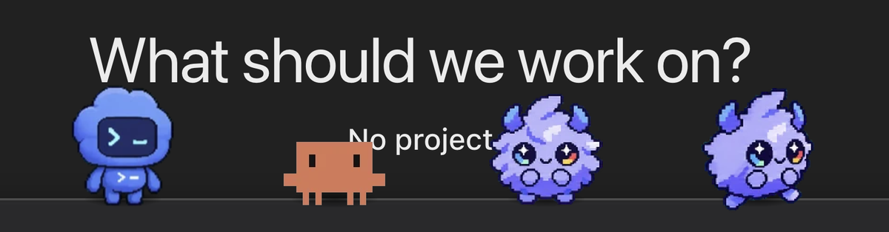
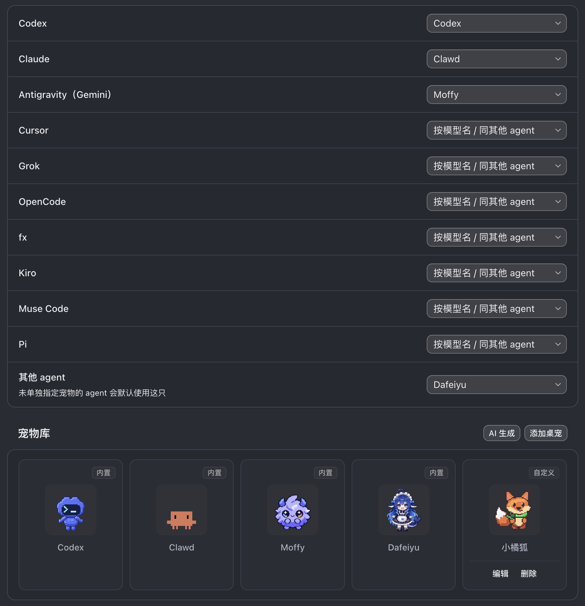

# Desk pets（桌宠）

Pets for the current agent stand on the composer and react to the thread state; each subagent sends its own pet to work alongside. Choose a pet per agent, edit the pet library, or have one of your agents generate a new pet from a description or reference images.

输入框上沿站着当前 agent 的宠物，跟着会话状态动；子代理各派一只到旁边干活。每个 agent 用哪只、宠物库都能自己改，也能让你配置的 agent 照描述或参考图生成新宠物。

Built in: a Codex-style pet for Codex, Clawd for Claude, Moffy for Antigravity (Gemini), and Dafeiyu, a whale-girl maid, for every other agent.

内置四只：Codex 用 Codex 风格的那只，Claude 用 Clawd，Antigravity（Gemini）用 Moffy，其他 agent 默认用鲸鱼娘女仆 Dafeiyu。






An extension for [T3 Code Extensions](https://github.com/ZiHao256/t3code-extensions), an unofficial extension host for [T3 Code](https://github.com/pingdotgg/t3code). Install it in Settings → Extensions → Browse, or paste `https://github.com/ZiHao256/t3x-desk-pets` into the URL field there. "Check for updates" offers this repository's latest release, installed after you confirm.

[T3 Code Extensions](https://github.com/ZiHao256/t3code-extensions) 的扩展。在 设置 → 扩展 →“浏览”里安装，或者把 `https://github.com/ZiHao256/t3x-desk-pets` 粘贴到那里的链接框。“检查更新”取本仓库的最新 Release。

## Install with an agent / 让 agent 安装

Paste this to Claude Code, Codex or another coding agent. 把下面的提示词发给 Claude Code、Codex 等 coding agent。

```text
Install the T3 Code extension "Desk pets" (https://github.com/ZiHao256/t3x-desk-pets) on this Mac.
1. Check that T3 Code Extensions 0.3 or later is installed (`git describe --tags` in its checkout shows v0.3.0 or later). If it is missing or older, install or update it first by following the "Install with an agent" section of https://github.com/ZiHao256/t3code-extensions, and ask me before quitting T3 Code.
2. Open ~/Applications/T3 Code Extensions.app, go to Settings → Extensions → Browse, and install "t3x-desk-pets" from the community list, or paste https://github.com/ZiHao256/t3x-desk-pets into the link field and click Add. In the confirmation dialog, check that the source is ZiHao256/t3x-desk-pets before confirming.
3. In the Installed tab, make sure it is enabled and tell me its version.
If you can't operate the app's UI, do step 1, then tell me exactly what to click for steps 2 and 3.
```

```text
帮我在这台 Mac 上给 T3 Code 装「桌宠」扩展（https://github.com/ZiHao256/t3x-desk-pets）。
1. 确认已安装 T3 Code Extensions 0.3 或更新版本（在它的仓库目录跑 `git describe --tags`，应为 v0.3.0 或更新）。没装或版本旧，先按 https://github.com/ZiHao256/t3code-extensions 里「让 agent 安装」一节装好；要退出 T3 Code 前先问我。
2. 打开 ~/Applications/T3 Code Extensions.app，进入 设置 → 扩展 →「浏览」，在社区扩展里安装 t3x-desk-pets；或者把 https://github.com/ZiHao256/t3x-desk-pets 粘贴到链接框里点「添加」。确认框里核对来源是 ZiHao256/t3x-desk-pets 再确认。
3. 在「已安装」里确认它已启用，告诉我版本号。
如果你没法操作应用界面，做完第 1 步后，把第 2、3 步具体点哪里告诉我。
```

## Generate a pet with an agent / 让 agent 生成桌宠

Settings → Desk pets → Pet library → **Generate with AI**:

1. Enter a name, describe the pet, and optionally attach up to 4 reference images. Pick pixel art or a smooth illustration.
2. Choose where it runs: a new thread in "No project" or one of your projects, or an existing thread. For a new thread, also choose the harness (any provider you have configured in T3), the model and the runtime mode. An existing thread keeps its own harness.
3. Click **Generate**. The extension sends the brief to that thread; the agent draws the 8×11 sprite sheet and saves it to the extension's output folder (`<T3 data folder>/t3x-out/desk-pets/<job>/`). Writing there is outside the agent's workspace, so a sandboxed agent may ask you to approve it in the thread. Image-generation models give the best results; others draw pixel art with code. It usually takes 10–20 minutes, and you can close Settings in the meantime.
4. When the sheet arrives, preview every animation, adjust the name, scale and pixel options, and import it into the library. Not happy? Describe what to change and the same thread revises it into a new round folder; if a revision goes wrong, you can go back to the previous version.

This uses your own agent quota. The extension only starts threads or sends messages when you click Generate or send a revision. The agent has to run on this Mac (a local environment): the output folder is read from the local disk.

设置 → 桌宠 → 宠物库 →「AI 生成」：

1. 填名字、写描述，可以附最多 4 张参考图；选像素画或平滑插画。
2. 选在哪儿跑：在「无项目」或某个项目里新开会话，或者发到已有会话。新会话还要选 harness（T3 里配好的任意 provider）、模型和运行模式；已有会话沿用它自己的 harness。
3. 点「生成」，扩展把要求发给那个会话，agent 画好 8×11 精灵图，存进扩展的输出目录（`<T3 数据目录>/t3x-out/desk-pets/<任务>/`）。那里在 agent 工作区之外，沙箱模式下它可能在会话里请你批准。能出图的模型效果最好，不能出图的会用代码画像素画。一般要十几分钟，期间可以关掉设置。
4. 图到了以后可以逐个动作预览，调名字、缩放和像素选项，再导入宠物库。不满意就写下要改什么，同一个会话接着改，每轮写进新文件夹；改坏了可以回到上一版。

用的是你自己的 agent 额度；只有你点「生成」或发修改意见时，扩展才会开会话、发消息。agent 要跑在这台 Mac 上（本机环境），输出目录是从本机磁盘读的。


## Requirements / 依赖

`apiVersion` 5 with the `agent` permission: needs T3 Code Extensions 0.3 or later. Older hosts refuse to install this version. The install dialog lists the permission.

依赖宿主的 `host` 接口（`apiVersion` 5，声明了 `agent` 权限），不直接读 T3 的页面结构。需要 T3 Code Extensions 0.3 起，旧版宿主会拒绝安装；安装确认框里会列出这项权限。

The pet swells as the thread's context fills up and squeezes itself back while T3 compacts history. This needs a host that passes `context` / `compacting` to `chat.overlay` (T3 Code Extensions 0.2+); on older hosts the pet just keeps its size.

宠物随会话上下文变满逐渐变胖，T3 压缩历史时把自己挤小、压完“噗”地弹回。需要宿主给 `chat.overlay` 传 `context` / `compacting`（T3 Code Extensions 0.2 起）；旧宿主上宠物保持原样大小。

## Development / 开发

- `npm test` runs the tests (Node 22+, no dependencies). 运行测试，不依赖 npm 包。
- To try changes: Settings → Extensions → Add local extension, pick this folder, then click refresh on its card after each edit. 试改动：设置 → 扩展 →“添加本地扩展”选本仓库目录，改完点卡片上的刷新。
- `tools/swell-demo.html`: open it in a browser to tune the swell / squeeze animation with a slider. 浏览器打开它，用滑块调膨胀和压缩动画。

## Sprite sheet / 精灵图格式

Settings → Desk pets → Add desk pet takes a sheet in this format; the generator asks the agent for the same.

设置里「添加桌宠」直接导入这种格式的图，AI 生成也让 agent 按它来画。

8 列 × 11 行，每格 192×208（整张 1536×2288），和 Codex 桌宠的图集格式一致：

| 行 | 动作 | 行 | 动作 |
|---|---|---|---|
| 0 | 待机 | 6 | 等待 |
| 1 / 2 | 向右 / 向左跑 | 7 | 运行中 |
| 3 | 挥手 | 8 | 审阅 |
| 4 | 跳 | 9–10 | 16 个方向的看向帧（0° 朝上顺时针） |
| 5 | 失败 | | |

宠物定义（`pets.js` 里的条目，设置里添加的宠物也用这些字段）：`name`、`scale`（0.5–2）、`pixelFx`（粒子用像素方块）、`smooth`（非像素画）、`badgeBottom`（子代理 “+N” 徽标高度）、`vars` / `darkVars`（`--t3x-pet-*`、`--t3x-sub-*` CSS 变量，用来校准落地位置和粒子颜色，见 `pets.css` 的默认值）。自带的 Codex 风格宠物由 `tools/codex_atlas.py` 用代码逐帧画出。

## Release / 发版

1. Change the code, bump `version` in `plugin.json`, run `npm test`, and commit. 改代码和 `plugin.json` 的 `version`，跑测试，提交。
2. Tag that commit `v<version>`, push it with the tag, and publish a GitHub release ("check for updates" reads the latest release). 在这个提交上打 `v<version>` 标签，连标签一起推送并发布 Release（“检查更新”看的是最新 Release）。

## License

MIT

The Clawd and Moffy sprites are the author's own non-commercial fan pixel art; the characters belong to their respective owners (Clawd is Anthropic's Claude mascot) and are not covered by the MIT license. Open an issue to request removal.

Clawd、Moffy 精灵图是作者自己绘制的同人像素形象，仅供非商业使用；角色形象归原权利方所有（Clawd 是 Anthropic 的 Claude 吉祥物），不在 MIT 授权范围内。如有异议请开 issue，会撤下。

The Dafeiyu sprite sheet (`pets/whale/`) is an unofficial fan work of the whale girl (鲸鱼娘, nicknamed 大肥鱼 "Dafeiyu"), a character the community built around DeepSeek's whale logo; she is not an official DeepSeek character, and this project is not affiliated with DeepSeek. The sheet is based on the chibi reference sheet "Q 版大肥鱼" (`characters/dafeiyu/reference-sheets/dafeiyu-chibi-character-sheet.png`) from the community asset library [TreapGoGo/deepseek-whale-girl](https://github.com/TreapGoGo/deepseek-whale-girl). The character is commonly credited to 溟月 (Mingyue), an original character by the Bilibili creator 上善无形 (June 2025), later reworked into the maid version by ZipZipPipe. The sheet is not covered by the MIT license: it is shared under [CC BY-NC-SA 4.0](https://creativecommons.org/licenses/by-nc-sa/4.0/) (attribution, non-commercial, share-alike). If you are a rights holder and object, open an issue and it will be removed.

Dafeiyu 精灵图（`pets/whale/`）是鲸鱼娘（又称“大肥鱼”）的非官方同人作品。鲸鱼娘是社区围绕 DeepSeek 鲸鱼标志创作的形象，不是 DeepSeek 官方角色，本项目与 DeepSeek 无关。这张图参考了社区资源库 [TreapGoGo/deepseek-whale-girl](https://github.com/TreapGoGo/deepseek-whale-girl) 里的「Q 版大肥鱼」设定图（`characters/dafeiyu/reference-sheets/dafeiyu-chibi-character-sheet.png`）。这个形象一般认为源自 B 站 UP 主「上善无形」2025 年 6 月的原创角色「溟月」，之后由 ZipZipPipe 二创为女仆装版本。这张图不在 MIT 授权范围内，按 [CC BY-NC-SA 4.0](https://creativecommons.org/licenses/by-nc-sa/4.0/deed.zh-hans)（署名、非商业、相同方式共享）提供。原作者或权利方如有异议，请开 issue，会撤下。
